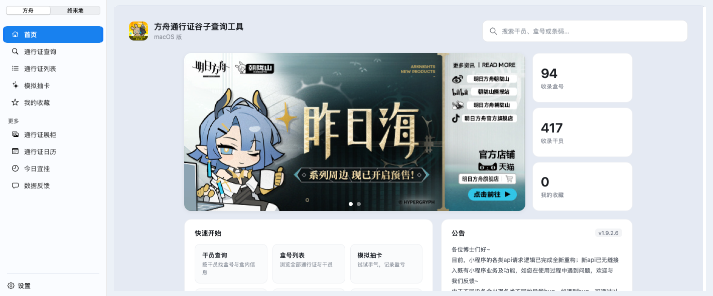
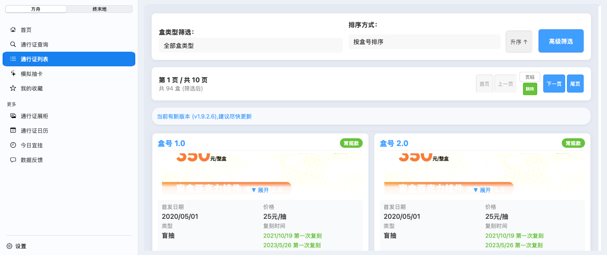
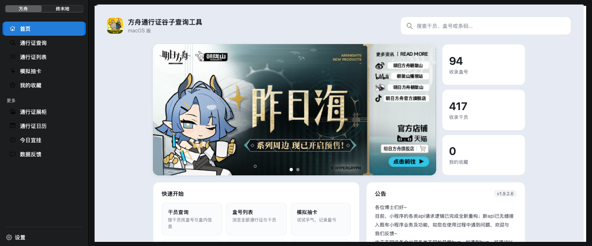
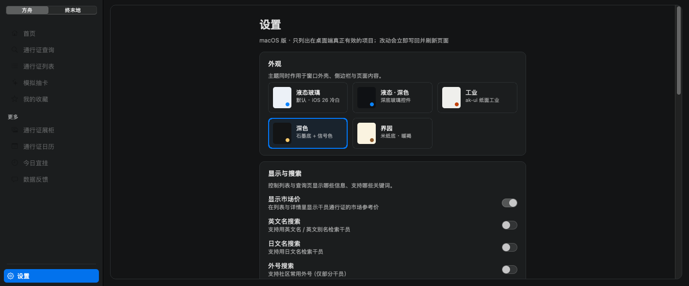
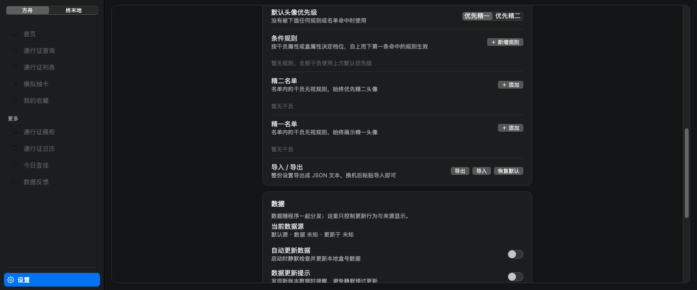
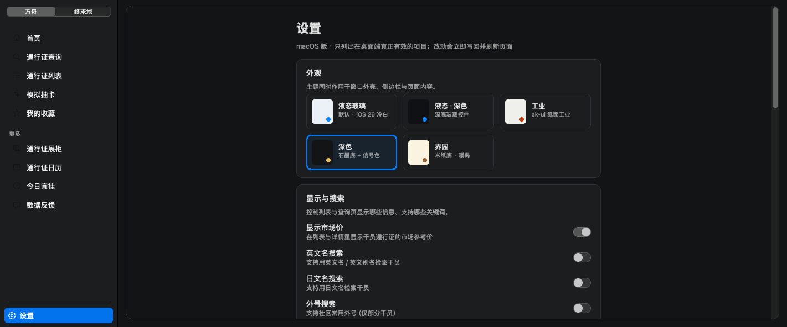
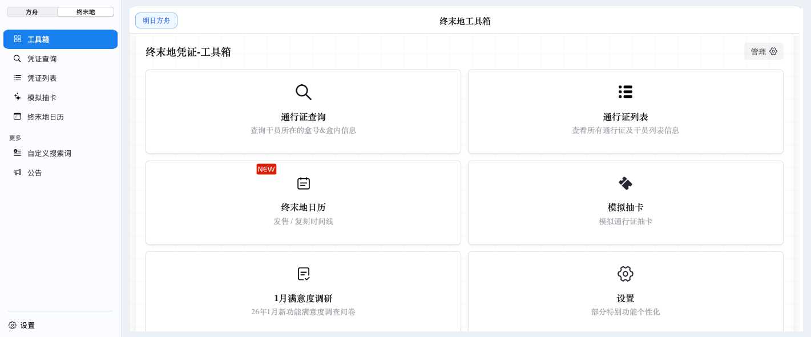
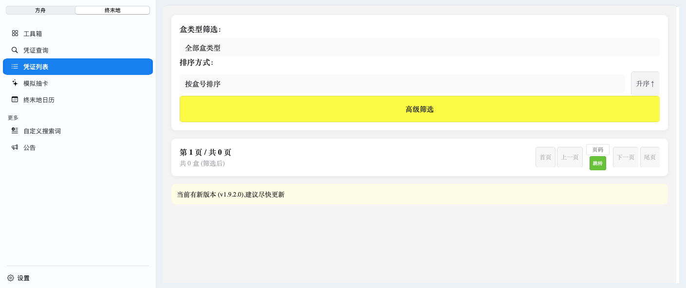

# 通行证查询 · macOS 版

用 **Swift + AppKit + WKWebView** 做外壳，承载仓库里已有的 uni-app H5 产物。
**业务代码零改动**，macOS 侧只负责窗口、系统集成和桌面端补丁 —— 和 `windows/` 里
WinUI 3 外壳的思路一致，只是把 Windows App SDK 换成了系统自带的 WebKit。

当前版本：`0.4.0`（侧边栏 + 工具包切换 + 图床修复 + 原生设置页，可日常使用；热键 / 自启 / 自动更新尚未实现）



## 为什么不是「让 WinUI 3 跑在 Mac 上」

WinUI 3 依赖 Windows App SDK / WinRT / DWM 合成器，没有跨平台运行时，
Wine / CrossOver 也撑不起来。而这个 App 的全部功能都在 H5 里，
Windows 版 `MainWindow.xaml.cs` 只是外壳（76 KB 的导航与桥接逻辑），
所以正确做法是**换壳**，不是移植。

选 Swift 而不是 Uno / Avalonia / Tauri 的原因：这台机器上只有 Command Line Tools
（没有 dotnet、没有 Rust、没有 Xcode），而 `swiftc` 直接就能编出原生 `.app`，
体积约 4.6 MB、启动即时、零额外运行时。

## 已实现

| 能力 | 说明 |
|---|---|
| 窗口 | 1180×840 首启居中，位置尺寸记忆，最小 1000×620 |
| **原生侧边栏** | 9 个顶层路由 + 分组标题 + 底部设置项，`⌘⌥S` 折叠 |
| **工具包切换** | 侧边栏顶部分段控件在「方舟 ⇄ 终末地」之间切换，各带一套导航；`⌘1` / `⌘2`，记住上次选择 |
| **路由双向同步** | 点侧边栏 → H5 换页；H5 内部跳转 → 侧边栏选中项反向对齐（跨工具包也会跟着换目录） |
| **原生设置页** | 外观（6 套主题 · 实时换色）、显示与搜索、干员头像个性化（条件规则 + 两份名单 + 导入导出）、数据、窗口、关于；写回仍是 uni 的 `localStorage`，与手机端共用同一份数据 |
| **内容卡片** | 圆角 12pt 卡片 + 主题边框，对应 Windows 的 `ContentCard` |
| **宽窄布局** | 首页放宽到 1180pt，工具页锁 1060pt（超了 rpx 会把移动端布局拉变形） |
| 桌面首页 | 直接落到 `#/pages/desktop_home/desktop_home` |
| 字号修正 | 强制 `html{font-size:18px}`，抵掉 uni-app 的 rpx 等比放大 |
| 禁缩放 | 拦掉 ⌘+滚轮、捏合、⌘+/-/0 |
| 顶层页去标题栏 | 18 个顶层路由隐藏 uni 自带 44px 标题栏 |
| 主题跟随 | 前端 6 套主题（含 liquidDark）实时同步侧边栏 / 卡片 / 留白，深色主题切 `darkAqua` |
| 跨域代理 | `/proxy` 代取 `raw.gitcode.com` / jsdelivr / githubusercontent 并补 CORS |
| 图床代理 | B 站 / 微博防盗链图床改写到 `/proxy`（补 Referer），三层拦截见下 |
| JS 桥 | `chrome.webview.postMessage` 垫片，前端已有桥调用零改动 |
| 菜单 / 托盘 | 标准菜单栏（含编辑菜单，否则 ⌘C/⌘V 失效）+ 菜单栏托盘图标 |
| 外链 | 一切非本站链接交给系统浏览器 |
| 诊断 | `~/Library/Application Support/AkPassport/shell.log`，含页面 JS 报错转发 |



深色主题（Ark）下的侧边栏与卡片：



侧边栏底部「设置」进的是原生页，和 Windows 版同一套设计 —— 值仍然写回 `localStorage`，
所以手机端、Windows 端、macOS 端看到的是同一份设置：



干员头像个性化：条件规则按「职业 / 分支 / 稀有度 / 词缀 …」组合，另有强制精一、精二两份名单。



深色主题下原生设置页同样跟随（侧边栏、卡片、开关一起换色）：



侧边栏顶部分段控件切到「终末地」，整套导航和首页一起换掉：





## 与 Windows 版的对应关系

| Windows (`windows/src/AkPassport.Win`) | macOS (`macos/src/AkPassportMac`) |
|---|---|
| `WebView2` + `SetVirtualHostNameToFolderMapping` | `WKWebView` + 本地 HTTP 服务（`LocalServer.swift`） |
| `NavigationView` + `BuildNav()` 动态菜单 | `Sidebar.swift`（`NSTableView` + `.sourceList`，数据同源 `NavCatalog`） |
| `OnNavSelectionChanged` / `SyncNavFromUrl` | `navigate(to:)` + `routeReport` 注入脚本 + `syncSelection` |
| `ApplyContentWidth`（宽窄画布） | 卡片宽度约束 + `switchLayout(wide:)` |
| （Windows 版无对应物，前端只给了移动端入口） | 工具包切换：`Toolkit` × 2 + 侧边栏分段控件 + `⌘1` / `⌘2` |
| `LocalProxy` / `RemoteProxy`（补 CORS 头） | `/proxy` 端点（同源请求，天然无 CORS） |
| `DesktopPatches`（6 段注入脚本） | `Patches.swift`（逐条移植 + 5 段新增） |
| `TrayService`（Shell_NotifyIcon） | `NSStatusItem` |
| `WindowStateStore`（window.json） | `NSWindow.setFrameAutosaveName` |
| `ShellTheme`（6 套色板） | `ShellTheme.swift`（同值移植） |
| `SettingsView`（6 张卡片）+ `SettingsBridgeScript` | `Settings.swift` + `SettingsStore.swift`（不注入桥，直接读写 `localStorage`） |
| `CharRoster.cs`（干员属性表） | `CharRoster.swift`（逐值转换） |
| `Diag`（shell.log） | `Diag.swift`（同路径约定） |
| `installer/`（WinForms 安装器） | 暂无（直接分发 `.app` / DMG） |
| `UpdateService` + `AkPassport.Updater` | 暂无（macOS 需改用 Sparkle，不能替换已签名 bundle） |

## 目录

```
macos/
├─ src/AkPassportMac/
│  ├─ main.swift          进程入口
│  ├─ AppDelegate.swift   窗口、分栏、菜单、托盘、生命周期
│  ├─ Sidebar.swift       原生侧边栏（导航目录、行视图、选中态）
│  ├─ Settings.swift      原生设置页（卡片布局、主题网格、开关行）
│  ├─ SettingsStore.swift localStorage 读写（uni 的 {type,data} 包装格式）
│  ├─ AvatarSettings.swift 头像个性化卡片 + 规则编辑器 + 干员选择器
│  ├─ CharRoster.swift    干员属性选项表（由 CharRoster.cs 生成）
│  ├─ WebShell.swift      WKWebView 配置、JS 桥、导航策略、快照工具
│  ├─ LocalServer.swift   本地静态服务 + 跨域代理
│  ├─ Patches.swift       注入脚本（移植自 DesktopPatches.cs）
│  ├─ ShellTheme.swift    主题色板
│  ├─ Paths.swift         落盘路径
│  └─ Diag.swift          日志
├─ wwwroot/               H5 产物（由 scripts/sync-web.sh 同步）
├─ scripts/sync-web.sh    从 windows 目录同步前端产物
├─ Info.plist             未签名应用描述（含 ATS 本地网络白名单）
├─ build.sh               一键出 dist/AkPassport.app
└─ run.sh                 构建并前台运行（日志直接打终端）
```

## 构建与运行

```bash
cd macos
bash scripts/sync-web.sh      # 首次：同步 wwwroot（需要 ../upstream 仓库）
bash build.sh                 # 产出 dist/AkPassport.app（约 4.6 MB）
open dist/AkPassport.app

# 开发模式（终端看日志 + 允许 Safari 网页检查器）
bash run.sh
```

前置条件只有一个：**Xcode Command Line Tools**（`xcode-select --install`），
不需要完整 Xcode、不需要 dotnet、不需要 Node。

### 调试参数

```bash
AKPASSPORT_ROUTE=pages/Search/Search ./dist/AkPassport.app/Contents/MacOS/AkPassportMac
AKPASSPORT_DEV=1 ./dist/AkPassport.app/Contents/MacOS/AkPassportMac   # 开 isInspectable
AKPASSPORT_THEME=ark ./dist/AkPassport.app/Contents/MacOS/AkPassportMac  # 强制外壳主题（配色核对）

# 自动化探针：等首屏稳定后真点一下侧边栏那一项，验证「点击 → 路由 → 选中」整条链路
AKPASSPORT_NAV_TEST=pages/list/list ./dist/AkPassport.app/Contents/MacOS/AkPassportMac
AKPASSPORT_SIDEBAR_TEST=1 ./dist/AkPassport.app/Contents/MacOS/AkPassportMac   # 3 秒后折叠侧边栏
AKPASSPORT_TOOLKIT_TEST=ends ./dist/AkPassport.app/Contents/MacOS/AkPassportMac  # 2.2 秒后点「终末地」分段
AKPASSPORT_IMG_PROBE=8 ./dist/AkPassport.app/Contents/MacOS/AkPassportMac        # 8 秒后把每张图的尺寸写进日志

# 原生设置页
AKPASSPORT_ROUTE=native/settings ./dist/AkPassport.app/Contents/MacOS/AkPassportMac
AKPASSPORT_SETTINGS_TEST=1 ./dist/AkPassport.app/Contents/MacOS/AkPassportMac      # 2.6 秒后真点侧边栏底部「设置」
AKPASSPORT_SETTINGS_TEST=1 AKPASSPORT_SETTINGS_BACK=1 ...                          # 再点回首页，验证原生页退场
AKPASSPORT_SETTINGS_THEME_TEST=ark ...                                            # 点「深色」瓦片并打印 localStorage 实际值
AKPASSPORT_SETTINGS_SCROLL=760 ...                                                # 截图前滚到该偏移
```

`AKPASSPORT_SETTINGS_THEME_TEST` 会在动作完成后把 `themeMode` / `showMarketPrice` /
`updateNotifyEnabled` 等 key 的**原始值**打进日志 —— 写入格式对不对，一眼就能看出来：

```
themeMode = ark
showMarketPrice = true
updateNotifyEnabled = {"type":"boolean","data":false}
```

`AKPASSPORT_IMG_PROBE` 输出形如 `img FAIL [bg/div] 0x0 box=680x316 complete=true url(...)`：
`FAIL` 是没画出来的图，`[bg/div]` 表示它是靠背景图画的（uni 的 `<image>`）。

### 无头截图（回归用）

不需要「屏幕录制」权限，走 `WKWebView.takeSnapshot`：

```bash
AKPASSPORT_ROUTE=pages/list/list \
AKPASSPORT_SNAPSHOT=/tmp/list.png \
AKPASSPORT_SNAPSHOT_DELAY=12 \
AKPASSPORT_EXIT_AFTER_SNAPSHOT=1 \
./dist/AkPassport.app/Contents/MacOS/AkPassportMac
```

加 `AKPASSPORT_SNAPSHOT_MODE=window` 则截「整窗」：先 `cacheDisplay` 画出原生部分
（侧边栏、卡片底、边框），再把 `takeSnapshot` 的网页像素按真实坐标合成上去。
不能直接 `cacheDisplay` 整个 `contentView` —— WKWebView 由独立进程渲染，
AppKit 这条路径只能拿到一块空白。

## 六个关键设计

**1. 为什么起本地 HTTP 服务，而不是 `loadFileURL`**

产物是 `type="module"` 的 ES module，`file://` 下会被 CORS 判死（Origin null）。
本地服务同时解决三件事：ES module 可加载；端口固定 → origin 固定 → localStorage
（收藏 / 设置 / 抽卡记录）跨启动保留；页面与 `/proxy` 同源 → 前端请求天然没有 CORS。

**2. 端口 23517 千万不要改**

改端口等于换 origin，用户所有本地数据都会「凭空消失」——
这和 Windows 版强调「WebView2 用户数据目录必须固定」是同一件事。
端口被占用时程序会明确报错并给出 `lsof` 排查命令，而不是静默换端口。

**3. 侧边栏怎么和 H5 路由对上**

难点不在画界面，在于**双向同步而不打转**：

- 点侧边栏 → 执行 `uni.reLaunch({url:'/xxx'})`（与 Windows 同一策略），失败回落 `location.hash`
- H5 内部跳转 → WKWebView **不会**给任何回调（hash 变化不触发导航代理），
  所以注入 `routeReport` 脚本，挂 `hashchange` + 拦截 `history.pushState/replaceState` 上报
- 防回环：侧边栏记住 `currentRoute`，收到上报时若与选中项一致就不再触发导航；
  不用 `tableView.action`（它在程序化选中、首次布局时都会发，实测会误触发一次导航）

`.sourceList` 样式虽然好看，但有两处必须绕开：它会往视图树塞一层 `NSVisualEffectView`
当材质（把自定义底色冲成系统灰 #E4E4E4），而且**不走** `drawSelection(in:)`
（实测该方法一次都没被调用）。两处都得自己接手：摘掉材质层、在 `draw` 里画选中胶囊。

侧边栏宽度也别指望 `setPosition` / `autosaveName` —— 在 `NSSplitViewController` 下
它们都会被内部约束覆盖（目标 212，最终永远回到 180）。直接把 `minimumThickness`
设成 212，最小值即默认值，用户仍可拖宽。

**4. 工具包切换为什么放在外壳，而不是页面里**

产物里本来就有两条线：方舟（`pages/` + `packageA/B`）和终末地（`package_ArknightEnds/`）。
前端只给了移动端首页一个「明日方舟 / 终末地」胶囊按钮作为入口，桌面首页根本没有口子。
所以把切换做成侧边栏顶部的原生分段控件：

- 一套 `Toolkit`（首页路由、路由前缀、主区、更多、设置项），方舟和终末地各一份，`NavCatalog.all` 驱动
- 归属判定靠路由前缀：`package_ArknightEnds/` 开头的算终末地，其余算方舟。
  这样**在页面内部跳转也会反向切换侧边栏**（比如终末地首页点进「凭证列表」，侧边栏自动换目录并选中对应行）
- 两个方向分开走，避免打转：用户点分段控件 → `activateToolkit` → 导航到该包的首页；
  H5 自己跳过去 → `syncSelection` → `applyToolkit`，只换目录不导航
- 选择落盘（`AkPassportToolkit`），下次启动直接回到上次那个包
- 页面自带的那颗切换胶囊用 CSS 隐藏（`.nav-switch-btn`），和原生控件重复

**5. 图床图为什么「一张都不显示」**

症状是首页横幅一块灰、盒号封面全灰、只有本地 logo 正常。走 `AKPASSPORT_IMG_PROBE`
一探就清楚：DOM 里连 `` 都没有，内层 `div` 是 `background-image: none`。

原因有两层：

1. **微博图床按 Referer 拦截**。页面来源是 `127.0.0.1:23517`，浏览器给图片请求带上的
   Referer 就是这个地址 → `403`（实测：无 Referer 200、带 `127.0.0.1` 403）
2. **uni-app 的 `<image>` 不是 ``**。H5 下它先用 `new Image()` 预加载，
   **加载成功才**把地址写进内层 `div` 的 `background-image`，失败就留 `none`。
   所以只改 `img[src]` 完全无效 —— 图还没进 DOM 就已经被判死刑了

修法是三层拦截，少一层就漏：

| 层 | 拦什么 |
|---|---|
| `HTMLImageElement.prototype.src` setter | `new Image().src = ...`（uni 的预加载器，主要就靠这层） |
| `Element.prototype.setAttribute` | Vue 渲染 `` 时的 `setAttribute('src')` |
| MutationObserver + 行内 `style` 扫描 | `background-image: url(...)` 直接写样式的场景 |

命中 `hdslb.com` / `biliimg.com` / `sinaimg.cn` 就换成 `/proxy?u=...`，
由 `LocalServer` 带正确的 Referer 取回。修完首页 2 张横幅、列表页 218 张图全部 `broken=0`。

**6. 原生设置页踩到的两个坑**

**① 写 `localStorage` 不能想当然**。三个约束叠在一起：

- uni-app 的 `setStorageSync` 对非字符串值会包一层 `{"type":"boolean","data":true}`，
  直接 `setItem(k, true)` 只会存成字符串 `"true"`，页面读到的类型就不对了
- 有几个开关偏偏要的就是字符串：`showMarketPrice` 等处前端写的是 `=== 'true'`，
  存成布尔反而是「看着改了、实际没生效」—— 所以分了两条写入路径（`stringBoolKeys`）
- `window.uni` 在内嵌 H5 里是**空对象**（uni 只活在模块作用域），只能操作裸 `localStorage`

改完值还要让页面看见：写入后防抖 350ms 再 `reload`，连续拨几个开关只重载一次。

**② 深色主题下侧边栏文字不会自己变色**。`NSColor.labelColor` 这类语义色是动态的，
但 `NSTextField.textColor` 在赋值那一刻就把它解析成了具体色值；换 `appearance` 之后
已经建好的 cell 不会重算 —— 表现就是深色背景上压着一串几乎看不见的深灰字。
所以侧边栏改成按明暗给实色（`NavRowCell.applyColors`），并在 `applyTheme` 里把可见
cell 挨个刷一遍。

## 已知问题

- **`pages/list/list` 有一条 Vue 内部报错**：`TypeError: null is not an object
  (evaluating 'e.effect.dirty=!0')`，被前端自己的 `errorLog` 捕获，不影响数据渲染；
  需确认 Windows 版是否同样存在（大概率是前端共性 bug，非外壳引入）。
- **终末地的公告 / 版本号接口写死成占位域名**：产物里是
  `https://YOUR_KNOW_CLOUD_CLIENT_ID.myminapp.com/...`，客户端没配这个值，
  所以终末地的公告区和「新版本」提示拿不到数据。这是前端构建配置问题，
  Windows 版同样如此；盒号数据走 `raw.gitcode.com`，不受影响。
- **终末地首次使用需要先下载数据**：进「工具箱」页执行一次下载，
  否则凭证列表显示「共 0 盒」（页面自己的提示，非外壳问题）。
- 未签名（ad-hoc）：本机可用，对外分发会触发 Gatekeeper，需要 Apple Developer 证书 + 公证。
- `pages/scan_barcode` 摄像头扫码未验证。

## 下一步（按优先级）

1. **全局快捷键**：`⌘⇧A` 唤回窗口（`NSEvent` 全局监听 + 辅助功能授权）。
2. **开机自启**：`SMAppService.mainApp.register()`（macOS 13+）。
3. **自动更新**：Sparkle 2 + edDSA 签名 appcast。
4. **打包分发**：DMG + 公证流水线；图标已从 `app-logo` 自动生成 `app.icns`。
